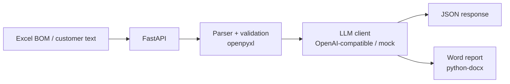

# BOM AI Service

A small Python microservice that uses an LLM to automate engineering paperwork:

- **`POST /v1/extract`**: turns a customer email or request ("250 pcs of the hopper bracket in stainless steel, 400 x 120 x 8 mm...") into structured JSON.
- **`POST /v1/bom/analyze`**: reads an Excel bill of materials (English or Dutch column names), calculates totals and weight per material, flags missing data, and adds an AI summary.
- **`POST /v1/bom/report`**: does the same and returns a ready-to-send **Word report**.

Built with FastAPI, the OpenAI SDK (works with any OpenAI-compatible provider such as Groq, OpenAI or Ollama), openpyxl and python-docx. Runs in **mock mode** without an API key, so it can be tested and demoed for free.



## Run locally

```bash
python -m venv .venv && source .venv/bin/activate   # Windows: .venv\Scripts\activate
pip install -r requirements-dev.txt
pytest -q                                            # 14 tests
uvicorn app.main:app --reload
```

Open http://localhost:8000/docs for the interactive API docs.

To use a real LLM, copy `.env.example` to `.env`, add your key, and export the variables (or set them in your shell) before starting.

## Try it

```bash
curl -X POST localhost:8000/v1/extract -H "Content-Type: application/json" \
  -d '{"text":"We need 250 pcs of the hopper bracket in stainless steel, 400 x 120 x 8 mm, before 2026-12-15. Supplier: MetaalTwente."}'

curl -F file=@sample_data/sample_bom.xlsx localhost:8000/v1/bom/analyze

curl -F file=@sample_data/sample_bom.xlsx localhost:8000/v1/bom/report -o report.docx
```

## Deploy (free, about 15 minutes)

1. Push this folder to a new public GitHub repo.
2. Get a free API key at https://console.groq.com (optional; without one it runs in mock mode).
3. On https://render.com: **New > Blueprint**, select the repo. Render reads `render.yaml`.
4. Paste your key into `LLM_API_KEY` and deploy. If Groq has retired the model in `render.yaml`, pick a current one from https://console.groq.com/docs/models and change `LLM_MODEL`.
5. Your API docs are live at `https://<your-app>.onrender.com/docs`.

The free Render plan sleeps after inactivity, so the first request can take ~30 seconds.

## Design choices

- **Provider-agnostic LLM client**: switching between Groq, OpenAI or a local Ollama model is a config change, not a code change.
- **Mock mode**: CI and demos never depend on a paid API or network.
- **Deterministic maths, LLM for language**: totals and weights are calculated in Python; the LLM only writes the summary and extracts text, so numbers can't be hallucinated.
- **Validation and clear errors**: wrong file type (415), too large (413), bad BOM data (422 with the row number), LLM failure (502).
- **Tests**: 14 pytest tests, including live-mode tests with a fake LLM client.

## Ideas for next steps

- Read CAD exports (STEP/DXF metadata) as an extra BOM source.
- Export a cleaned Excel file next to the Word report.
- Add authentication (API key header) and rate limiting.
